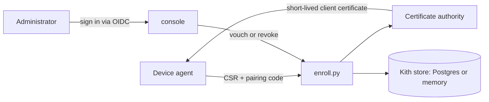

# muster

A device enrollment and identity plane for one household's endpoints.

Last checked against the code: 2026-11-01.

To muster is to assemble a company and take the roll. muster gives each phone,
router, laptop or IoT device a short-lived client certificate as its identity
and its membership.

## What it does

1. A device generates its own key and presents a CSR with a short-lived
   pairing code.
2. An administrator **vouches** for it, and muster issues the certificate. The
   device renews it when due.
3. Lapse and revoke are different acts: lapse is an identity that expires
   without renewal, while revoke is an administrator cutting a device off.
4. The pairing code is typed on the device, or carried in the provisioning QR.
   The two are not equally strong: [CONTEXT.md](CONTEXT.md) says how.

The six-tap QR flow provisioned a Pixel on 2026-08-19 with no cable, once; see
[docs/android-constraints.md](docs/android-constraints.md). muster exists
because mainstream MDM products and Android Management API refused the job, and
because of a decision in [zippie](https://github.com/quadseven/zippie):
[docs/why-it-exists.md](docs/why-it-exists.md).

## Quick start

```sh
git clone https://github.com/quadseven/muster.git
cd muster/server
uv run --group dev --python 3.12 python -m pytest -q
```

## How it works



Trust model and pairing shapes: [ARCHITECTURE.md](ARCHITECTURE.md). Reasons,
each with the failure behind it: [DECISIONS.md](DECISIONS.md).

## Run and test locally

From `server/`, with the settings below set:

```sh
uv run --python 3.12 uvicorn --factory muster.api:app_from_env --port 8000
```

It refuses to start and names what is missing.

`server tests` runs this, and it is the one lane check in `.loom/validation.conf`:

```sh
cd server && uv run --group dev --python 3.12 python -m pytest -q
```

Agent tests: `agent/tools/jvm-tests.sh` needs a JDK and the Gradle cache.
`cd agent/android && ./gradlew --no-daemon testDebugUnitTest` needs an Android
SDK. CI runs the Gradle one on a self-hosted Mac.

## Configuration

Settings come from the environment. The server refuses to start without these:

| Setting | What it does |
|---|---|
| `MUSTER_OIDC_ISSUER`, `_JWKS_URL`, `_AUTHORIZE_URL`, `_TOKEN_URL`, `_CLIENT_ID` | Administrator sign-in; see [docs/administrator-sign-in.md](docs/administrator-sign-in.md) |
| `MUSTER_ADMIN_SUBJECTS` | Comma-separated `sub` claims allowed to vouch |
| `MUSTER_CA_KEY`, `MUSTER_CA_CERT` | Paths to the CA key and certificate |
| `MUSTER_BASE_URL` | The address devices enroll against |
| `MUSTER_CRL_URL`, `MUSTER_OCSP_URL` | Plain http URLs stamped into every certificate |

Optional settings are in [docs/what-is-deployed.md](docs/what-is-deployed.md)
and [`.env.example`](.env.example). Without `MUSTER_DATABASE_URL` the kith is
held in memory. Not shipped: an OIDC provider, a CA key pair, a public
hostname, and an agent signing key.

## Status

Live for one household. The control plane runs as one replica on a Kubernetes
cluster, and `/readyz` on 2026-11-01 reported the Postgres kith, policy and
assets as ok. Open work: [goal issue](https://github.com/quadseven/muster/issues/124).

- Agent: Android only. Other devices use the same HTTPS protocol directly.
- Google Play: `app.muster.agent` is registered, per the operator. The public
  listing returned 404 on 2026-11-01, and no device installs from Play.
- Wipe: deployed, never exercised as of 2026-09-01. Unverified since.
- Retired: the shared bootstrap token. Sign-in is OIDC only.

## Contributing

Changes land through a pull request. `main` requires `server tests` and
`Grug - Chief`; the full merge gate is in [AGENTS.md](AGENTS.md). This
repository is public, so read that file first.

## How it deploys

A merge deploys nothing, to the server or to the site.

- Site: `site/` does not deploy on merge until
  [#210](https://github.com/quadseven/muster/issues/210) lands. It was open on
  2026-11-01, blocked on a workflow push and a Pages deploy token. The real
  path is a hand upload with `wrangler pages deploy site` to a Cloudflare Pages
  project. The domain apex is a hand-made CNAME to that project, outside
  Pulumi. Production holds whatever was last uploaded.
- Server: a merge touching `server/**` publishes
  `ghcr.io/quadseven/muster-server:sha-<12>`, a private package. An operator
  repins the digest in the manifest in the private infrastructure repo and
  applies it: [docs/what-is-deployed.md](docs/what-is-deployed.md).
- Agent: a finished `agent - android` run on `main` rebuilds the image, which
  bakes in the APK. New devices fetch `/agent.apk` at provisioning. Enrolled
  devices update only when the `install-apps` policy names a newer APK in the
  asset store, not through Play.

## Layout

    server/muster/enroll.py         the trust decision: mint, present, vouch, issue
    server/muster/kith.py           what muster remembers, and why the store may fail
    server/muster/administrator.py  who the human is, and how they sign in
    server/muster/console.py        the console's session, and what gets recorded
    server/tests/                   pytest suite
    agent/android/                  the Android agent
    site/                           static splash page, no build step
    docs/                           constraints and runbooks

## Docs

- [CONTEXT.md](CONTEXT.md): the five nouns. Read first.
- [docs/state-of-play.md](docs/state-of-play.md): dated live state.
- [docs/what-is-deployed.md](docs/what-is-deployed.md): how to recreate the
  deployment. Parts are stale.
- [docs/provisioning-a-pixel.md](docs/provisioning-a-pixel.md),
  [docs/signing-ceremony.md](docs/signing-ceremony.md).
