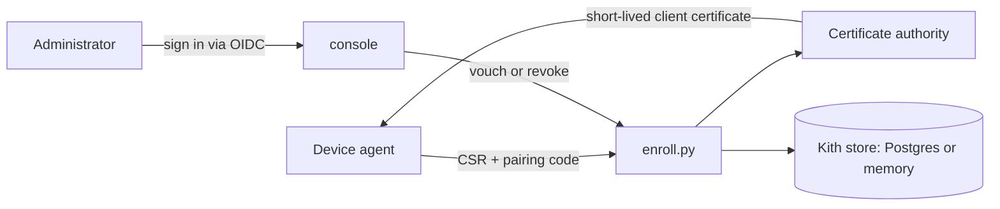

# muster

A device enrollment and identity plane for one household's endpoints.

To muster is to assemble a company and take the roll. muster enrolls one
household's phones, routers, laptops and IoT devices, gives each a short-lived
client certificate as its identity and its membership, and lets an
administrator vouch for a device or revoke it.

## What it does

1. A device generates its own key and presents a CSR with a short-lived
   pairing code.
2. An administrator **vouches** for it, and muster issues a short-lived client
   certificate. That certificate is the device's identity and its membership;
   it renews itself when due.
3. Lapse and revoke are different acts: lapse is an identity that expires
   without renewal, while revoke is an administrator saying the device is no
   longer ours.
4. The pairing code is either typed on the device by a person comparing a key
   fingerprint on two screens, or carried in the provisioning QR so nobody
   touches the handset at all. The two are not equally strong and
   [CONTEXT.md](CONTEXT.md) says exactly how they differ - read it before
   assuming either.

## Quick start

```sh
git clone https://github.com/quadseven/muster.git
cd muster/server
uv run --group dev --python 3.12 python -m pytest -q
```

That runs the enrollment exchange end to end with no HTTP, storage or device
involved. To serve it, set the settings under Configuration and start the
server the way its container image does:

```sh
uv run --python 3.12 uvicorn --factory muster.api:app_from_env --port 8000
```

It refuses to start, and says which setting is missing, until administrator
sign-in, the CA and the public URLs are set. Provisioning a handset is in
[docs/provisioning-a-pixel.md](docs/provisioning-a-pixel.md).

## How it works



The **agent** on the device (Android first, in `agent/`) generates the key
and enrolls. `server/muster/enroll.py` holds the trust decision: mint, present,
vouch, issue. The **administrator** signs in at the estate's identity provider
([docs/administrator-sign-in.md](docs/administrator-sign-in.md)); a device
enrolling has no credential and never needs one. The **CA** signs every
certificate, and the **kith** is what muster remembers about its devices.

[ARCHITECTURE.md](ARCHITECTURE.md) is the tour: the trust model, the two
shapes of pairing code, the certificate authority, and how a device gets from
a factory reset to a managed endpoint. [DECISIONS.md](DECISIONS.md) records
why it has that shape, each entry with the failure that caused it.

### Layout

    server/muster/enroll.py         the trust decision: mint, present, vouch, issue
    server/muster/kith.py           what muster remembers, and why the store may fail
    server/muster/administrator.py  who the human is, and how they sign in
    server/muster/console.py        the console's session, and what gets recorded
    server/tests/                   every way the exchange says no
    agent/                          per-platform agents; Android first
    docs/                           constraints and runbooks

## Run and test locally

The same command CI runs, so a green run here means a green run there:

```sh
cd server && uv run --group dev --python 3.12 python -m pytest -q
```

CI runs it on every pull request (`check.server.yml`), and
[`.loom/validation.conf`](.loom/validation.conf) names the same command. A
pull request that touches `agent/android/` also runs the agent's unit tests
(`check.agent-android.yml`):

```sh
cd agent/android && ./gradlew --no-daemon testDebugUnitTest
```

## Configuration

The server reads its settings from the environment. It refuses to start
without the first group:

| Setting | What it does |
|---|---|
| `MUSTER_OIDC_ISSUER`, `MUSTER_OIDC_JWKS_URL`, `MUSTER_OIDC_AUTHORIZE_URL`, `MUSTER_OIDC_TOKEN_URL`, `MUSTER_OIDC_CLIENT_ID` | Administrator sign-in at your identity provider |
| `MUSTER_ADMIN_SUBJECTS` | Comma-separated `sub` claims allowed to vouch for devices |
| `MUSTER_CA_KEY`, `MUSTER_CA_CERT` | Paths to the CA key and certificate |
| `MUSTER_BASE_URL` | The address devices enroll against, carried in the pairing QR |
| `MUSTER_CRL_URL`, `MUSTER_OCSP_URL` | Stamped into every certificate issued |

Optional: `MUSTER_OIDC_CLIENT_SECRET`, `MUSTER_OIDC_END_SESSION_URL`,
`MUSTER_DATABASE_URL` (the Postgres kith store; without it the kith is held
in memory, and muster says so at boot and on `/readyz`), `MUSTER_AGENT_APK`,
`MUSTER_POLICY_DIR`, `MUSTER_ASSET_DIR`, `MUSTER_COOKIE_SECURE`,
`MUSTER_LOG_LEVEL`, and `DD_AGENT_HOST` for metrics. The check-in settings are
in [`.env.example`](.env.example). Each is explained in
[docs/administrator-sign-in.md](docs/administrator-sign-in.md) and
[docs/what-is-deployed.md](docs/what-is-deployed.md).

What you bring, none of which ships with the repo: an OIDC identity provider,
a CA key pair, a public hostname for enrollment, optionally Postgres, and an
agent release signing key ([docs/signing-ceremony.md](docs/signing-ceremony.md)).

## Status

Early. The enrollment exchange is implemented and tested with no HTTP,
storage or device involved, which is deliberate: it is the part that has to
be right. Open work is tracked in the
[goal issue](https://github.com/quadseven/muster/issues/124).

## Contributing

Changes land through a pull request; direct pushes to `main` are refused.
A pull request must pass the server suite (`check.server.yml`), the leak scan
(`check.leak-scan.yml`), workflow hygiene when it touches `.github/`, the
Android agent tests when it touches `agent/android/`, and review by
`grug-tribe[bot]`.

Read [CONTEXT.md](CONTEXT.md) first - the same five nouns run through the
server, the agents and the console, and they mean exactly one thing each. Then
read [AGENTS.md](AGENTS.md): this repository is public.

## Why it exists

Every product tried first said no to the same modest ask - push and pull
configuration to a device the household owns, from one place.

- **A mainstream commercial MDM** applies policy on the free tier but will not
  install an application; that is Premium, and it is the one thing needed.
- **An open-source MDM** works and is free, but owns the launcher and brings a
  management model that is not wanted.
- **Android Management API** will not have us at all: its permissible-usage
  policy excludes "solutions developed and used exclusively for first party
  in-house applications", and enrollment fails on the handset at zero devices.

See [docs/android-constraints.md](docs/android-constraints.md) for what Android
actually permits, dated and cited. **Read it before designing any enrollment
UX.** The six-tap QR flow provisioned a Pixel on 2026-08-19 with no cable,
which is one device on one day past a Play Protect check that behaves like a
heuristic - so that file records it as open and measured once, and keeps the
adb route as the fallback.

muster exists because of a decision made in
[zippie](https://github.com/quadseven/zippie): a device should fetch its own
identity over its own credential, rather than have a deploy pipeline splice a
static secret into its config. Several decisions here started as incidents
there.
